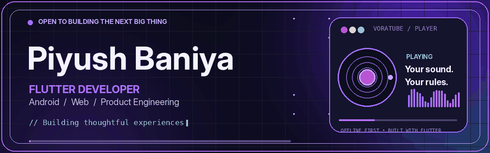
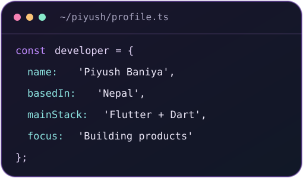
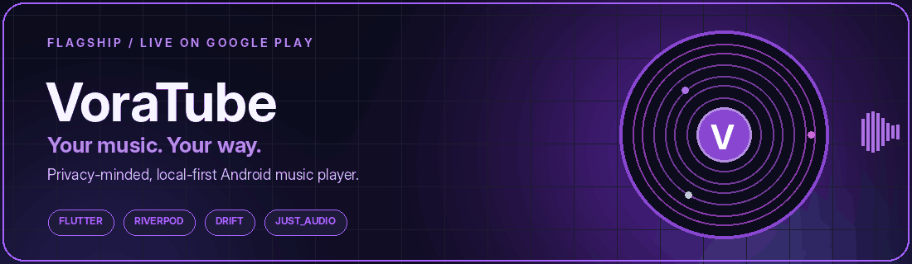
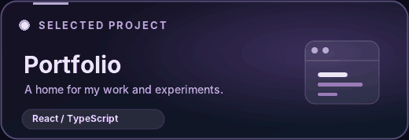
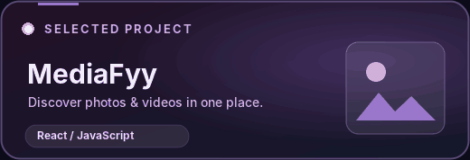
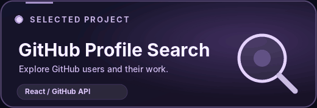
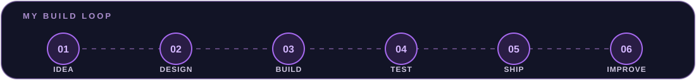

<!--
  PIYUSH BANIYA • GITHUB PROFILE
  The banner and VoraTube artwork are animated GIFs to work on GitHub.
  Asset paths are relative to this README. Keep the /assets directory when uploading.
  For setup instructions, see SETUP.md (do not upload SETUP.md if you prefer a cleaner repo).
-->

  
    
  
  
  
    
  
  
  

<h2>01 &nbsp; ◈ &nbsp; The developer behind the pixels</h2>

<table>
  <tr>
    <td width="54%" valign="top">
      <h3>Hey, I'm Piyush 👋</h3>
      
I'm a <b>Flutter-focused developer and product builder from Nepal</b>. I love turning early ideas into fast, thoughtful apps that people can actually use.

      
My main interests are <b>mobile engineering, offline-first experiences, polished UI/UX and native Android integration</b>. I also work across the web stack when an idea needs more than an app.

      
<b>Right now:</b> building and improving <a href="https://voratube.vercel.app/">VoraTube</a>, exploring new developer tools, and learning by shipping.

      
Outside code, you'll find me creating gaming and tech content.

    </td>
    <td width="46%" valign="top">
      
    </td>
  </tr>
</table>

<h2>02 &nbsp; ◈ &nbsp; The flagship project</h2>

  

  <b>VoraTube — an Android music player built around your own library.</b> 
  Local playback • Custom playlists • Lyrics • Audio controls • AMOLED-inspired design • Android Auto

  
  
  

Under the hood: Flutter · Dart · Riverpod · Drift · just_audio · audio_service · Android platform APIs

<h2>03 &nbsp; ◈ &nbsp; More things I've built</h2>

<table>
  <tr>
    <td width="50%">
      
    </td>
        <td width="50%">
      
    </td>
  </tr>
  <tr>
    <td width="100%">
      
    </td>
  </tr>
</table>

<a href="https://github.com/piyush-baniya?tab=repositories"><b>Explore all public repositories →</b></a>

<h2>04 &nbsp; ◈ &nbsp; The toolkit</h2>

<table>
  <tr>
    <td width="50%" valign="top">
      <b>📱 &nbsp; Mobile & app architecture</b>  
        
      Flutter · Dart · Kotlin · Android · Riverpod · Local databases
    </td>
    <td width="50%" valign="top">
      <b>🌐 &nbsp; Web & full stack</b>  
        
      React · TypeScript · Node.js · Express · REST APIs
    </td>
  </tr>
  <tr>
    <td width="50%" valign="top">
      <b>🧠 &nbsp; Languages & data</b>  
        
      Python · Django · SQL · HTML/CSS
    </td>
    <td width="50%" valign="top">
      <b>🛠️ &nbsp; Workflow & design</b>  
        
      Git · GitHub · VS Code · Vercel · UI/UX design
    </td>
  </tr>
</table>

<h2>05 &nbsp; ◈ &nbsp; What I'm exploring</h2>

  
  
  
  
  
  

<h2>06 &nbsp; ◈ &nbsp; The numbers behind the commits</h2>

  
  

Stats depend on a third-party image service and may be temporarily unavailable. Language breakdown reflects indexed public repository code, not a complete skill ranking.

<h2>07 &nbsp; ◈ &nbsp; Contributions in motion</h2>

<!-- Generated by .github/workflows/contribution-snake.yml.
     Run the workflow once after uploading; the image may not appear until then. -->

  

<h2>08 &nbsp; ◈ &nbsp; How I approach building</h2>

  

<i>"Build things that are useful, fast, private, and genuinely enjoyable to use."</i>

<h2>09 &nbsp; ◈ &nbsp; Let's connect</h2>

  
  
  
  
  

  

